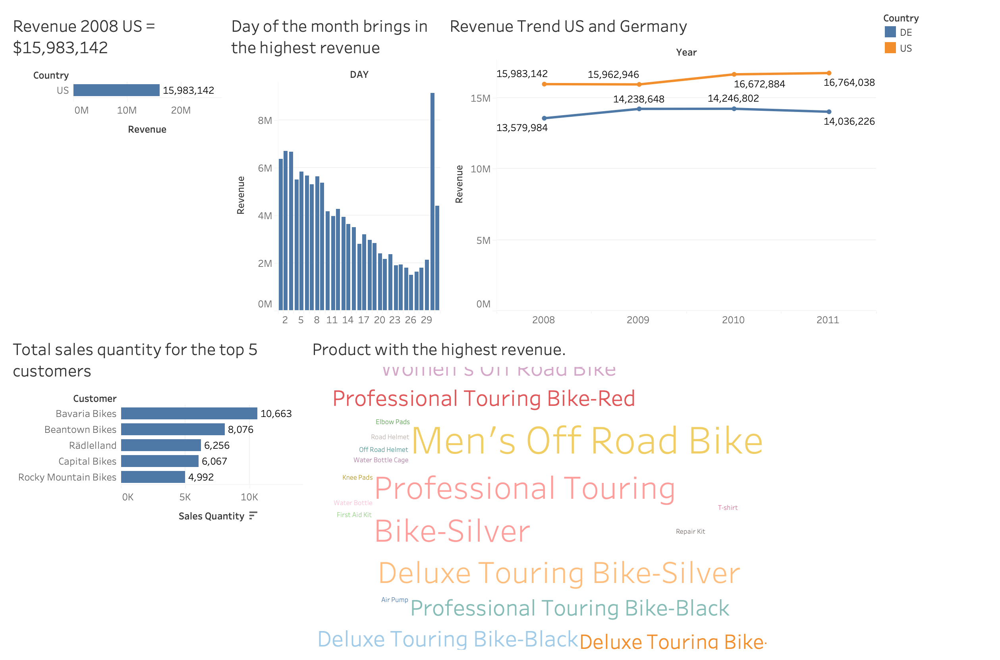
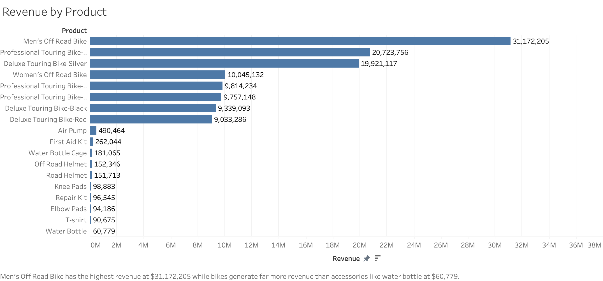
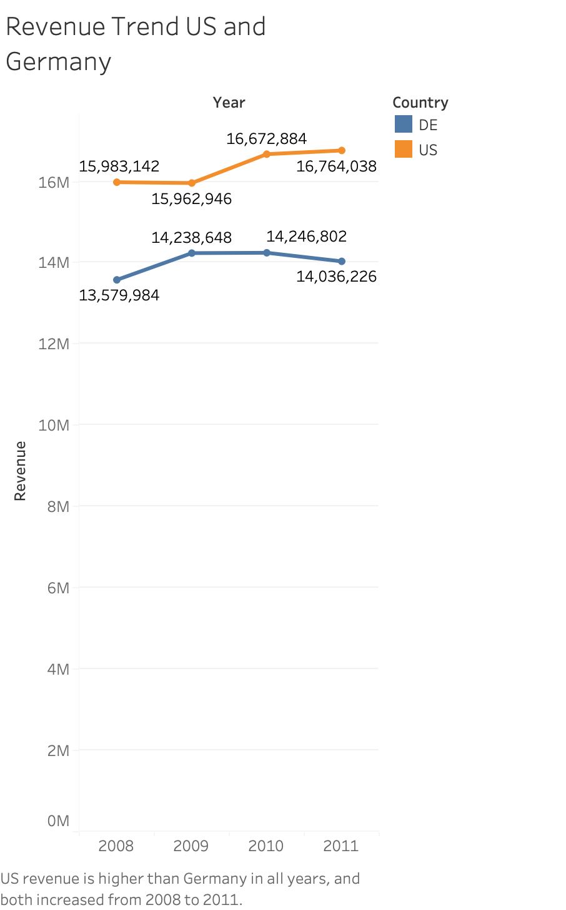
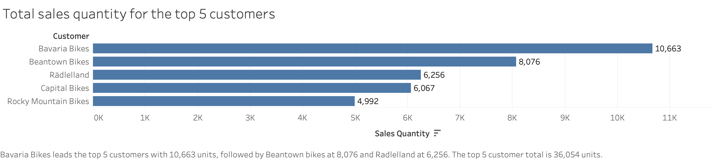
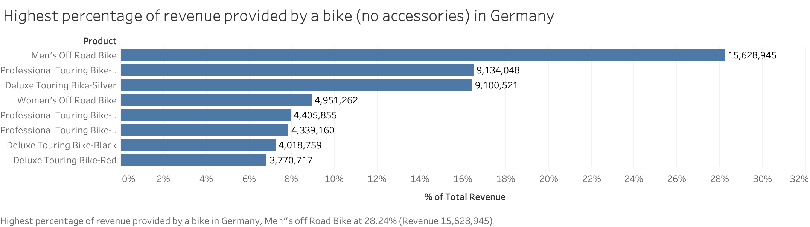

# World Bike Revenue Analysis (Tableau)

**Business questions:** Where does World Bike's revenue come from, how is it changing, and who are the biggest customers?
**Tools:** Tableau Desktop (bar and line charts, word cloud, dashboard), Excel
**Data:** 36,967 sales transactions, 2008–2011, for a bicycle company selling in the United States and Germany ([`data/WorldBike_Data.xlsx`](data/WorldBike_Data.xlsx)), provided for CSDA 5310 Data Visualization, Webster University.



## Key findings

| Question | Answer |
|---|---|
| Which country brings in more revenue? | **United States: 65.4M** vs Germany: 56.1M (2008–2011) |
| How is revenue changing? | Total revenue grew from **29.6M (2008) to a peak of 30.9M (2010)**, then dipped slightly to 30.8M in 2011 |
| Is the trend the same in both countries? | The US is higher every year; both countries grew from 2008 to 2011 |
| Which product earns the most? | **Men's Off Road Bike: 31.2M**. Bikes far outsell accessories (top accessory, Air Pump: 0.49M) |
| Which bike leads in Germany? | **Men's Off Road Bike: 28.2% of Germany's bike revenue** (15.6M) |
| Which day of the month brings the most revenue? | **Day 30 (9.1M)**, far ahead of any other day, which points to month-end ordering |
| When do customers buy the most? | Sales quantity peaks in **spring and early summer (April–June)**, with June highest (23,328 units) |
| Who are the top customers? | **Bavaria Bikes (10,663 units)**, Beantown Bikes (8,076), Rädlelland (6,256), Capital Bikes (6,067), Rocky Mountain Bikes (4,992) |

| Revenue by product | US vs Germany trend |
|---|---|
|  |  |

| Top 5 customers | Germany: bike revenue share |
|---|---|
|  |  |

## Recommendations

1. Protect and grow the bike lines, especially Men's Off Road Bike, which drives most revenue.
2. Plan inventory and staffing for the **April–June peak** and for month-end order spikes.
3. Build account plans for the top 5 customers, who buy 36,054 units between them.
4. Bundle accessories with bikes to lift their small share of revenue.

## Data note

Revenue is recorded in **local currency: USD for the United States and EUR for Germany**. The country comparison and the combined totals above mix the two currencies. A next step is to convert Germany's revenue to USD with yearly exchange rates before comparing.

## Files

```
worldbike-revenue-analysis/
├── tableau/WorldBike_Revenue_Analysis.twbx   # packaged workbook (open in Tableau Desktop or Tableau Public)
├── data/WorldBike_Data.xlsx                  # source data
└── images/                                   # dashboard and chart screenshots
```

---
**Author:** Salasaba Simpson, M.S. Business Analytics candidate, Webster University · [LinkedIn](https://www.linkedin.com/in/salasaba-simpson-jerry/)
